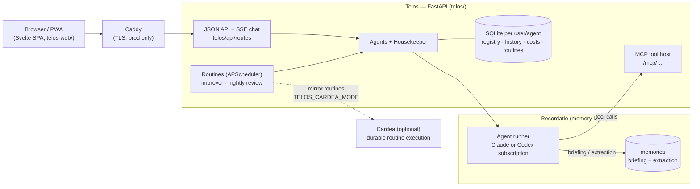

# τέλος (Telos)

**Personal AI agents that remember, run on a schedule and get better at their job.**

Telos is a self-hosted platform for long-running personal agents: research, monitoring, recurring reports. Each agent has one goal, its own tools and a system prompt that Telos keeps improving. You talk to agents in a web app, and they keep working when you're away: a routine runs each morning and emails you only what changed. It is built for a single owner or a small household.

## Why it exists

Chat assistants forget, wait to be asked and never get better at a task:

| Problem | What Telos does |
|---|---|
| Every conversation starts from zero | Each turn gets a **memory briefing** from [Recordatio](https://github.com/pasinit/recordatio), and what was learned is extracted afterwards. |
| Nothing happens unless you ask | **Routines** run an agent on a schedule and send the result by email. |
| One general assistant does everything badly | Each agent has **one goal** and a tool allowlist. A meta-agent, the Housekeeper (ταμίας), routes work to specialists and can hire new ones. |
| Prompts never improve | Every turn records quality signals (corrections, follow-ups, ignored answers). Every 50 messages an **improver** proposes a better prompt and a judge scores it. Each proposal is shown with its rationale and diff. |

## What it looks like

A property-search agent, set up once:

- **Goal:** "find two-bedroom rentals that meet strict criteria".
- **Tools:** `rightmove_search`, `agency_search`, the browser tools and an assessment ledger.
- **Routine:** each morning, search, assess new listings against the criteria and email only the changes since yesterday.

You can also chat with it at any time ("why did you reject the one on Elm Street?"). It answers from its ledger and its memory. [docs/homey](docs/homey/) has the full prompt and routine templates for this agent.

From Python, an agent is a goal plus a model loop:

```python
from telos import Agent, Goal

agent = Agent(Goal(name="job hunt", description="Help me find and land a senior engineering role."))
for chunk in agent.stream("I have a system design interview next Tuesday. What should I focus on?"):
    print(chunk, end="")
```

See [examples/](examples/) for more.

## Try it locally

You need:
- Python 3.13 and Node;
- a [Recordatio](https://github.com/pasinit/recordatio) checkout next to this one (`../recordatio`);
- GitHub credentials with access to one private Git dependency, because `make install` fetches it.

```bash
make install        # .venv with [dev,ui] extras
make web-install    # SPA dependencies
touch .env          # then add the settings below
make recordatio     # Recordatio on :8787 (separate terminal)
make dev            # FastAPI on :7433 + Vite on :5173
```

Open http://localhost:5173. The settings are read from the environment or `.env` (`telos/api/settings.py`). The ones you will want first:

| Variable | Default | Purpose |
|---|---|---|
| `RECORDATIO_URL` | `http://localhost:8787` | Recordatio endpoint |
| `TELOS_SUBSCRIPTION_PROVIDER` | `claude` | `claude` or `codex` ([details](CODEX_MIGRATION.md)) |
| `SEARCH_ENGINE` | `gemini` | `gemini`, `serper`, `serpapi`, `duckduckgo` or `bing`, each with its key |
| `SMTP_HOST`, `SMTP_PORT`, `SMTP_USER`, `SMTP_PASSWORD`, `SMTP_FROM` | — | Routine emails |
| `BASE_URL` | — | Public URL for email links, and for Recordatio to reach `/mcp` |

## What an agent can do

| Area | Tools |
|---|---|
| Web | `web_search`, `browser_open` / `_click` / `_fill` / `_read` / `_back` |
| Code | `python_exec`, `shell_exec` (sandboxed with bubblewrap, no network) |
| Google | `drive_search`, `gdocs_read` / `_append`, `gsheets_list_tabs` / `_read` / `_append` / `_update` (per-user OAuth) |
| Memory | `memory_recall` |
| Routines and email | `create_routine`, `list_routines`, `delete_routine`, `send_email` |
| Team | `coordinate`, `list_agents`, `agent_status`; Housekeeper only: `delegate_to`, `create_agent` |
| Property search | `rightmove_search`, `zoopla_search`, `agency_search`, `record_property_assessment`, `list_property_candidates` |
| MCP | `mcp:filesystem`, `mcp:github` |

## Where to go next

- [docs/deployment.md](docs/deployment.md): Docker, HTTPS, the sandbox, tracing and Google OAuth.
- [docs/homey](docs/homey/): a complete example agent and routine.
- [packages/telos-cardea](packages/telos-cardea/): running routines on [Cardea](https://github.com/pasinit/cardea).

## How it's built



The three pieces split the work like this:

- **Telos** owns the agents, tools, routines, UI, cost tracking and self-improvement.
- **[Recordatio](https://github.com/pasinit/recordatio)** runs each model turn. It injects the memory briefing, streams the turn back and extracts what was learned. Agent tools are served back to it by Telos's MCP host.
- **[Cardea](https://github.com/pasinit/cardea)** can run scheduled routines as durable, receipted agent runs. Set `TELOS_CARDEA_MODE` to `shadow` to compare against Telos, or to `live` to switch over. The operations Cardea may call are in [`packages/telos-cardea`](packages/telos-cardea/).

The Python package is layered `core → domain → transport → services → api`, and `make lint-imports` enforces the one-way imports.

## Contributing

| Command | What it does |
|---|---|
| `make test` | Python tests |
| `make lint-imports` | Layer contracts |
| `make web-check` / `make web-test` | Svelte type checks / SPA unit tests |
| `make cardea-ops-check` | Tests for `packages/telos-cardea` |

For UI changes, run `make dev` and try them in the browser. The frontend rules are in [telos-web/CONVENTIONS.md](telos-web/CONVENTIONS.md).

## License

MIT.
