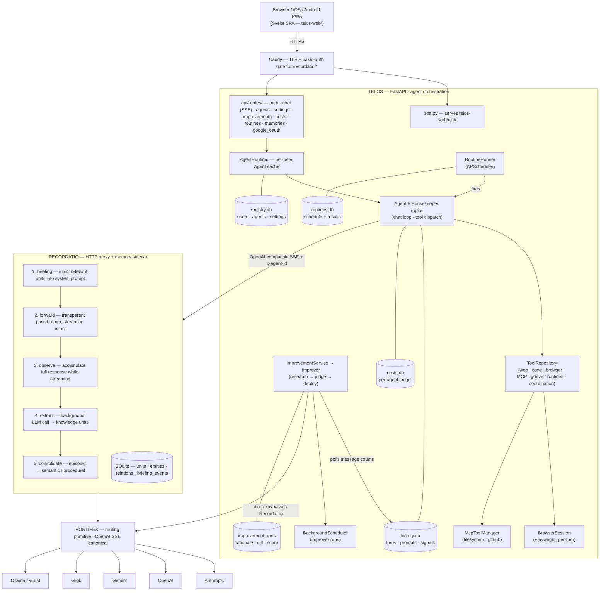
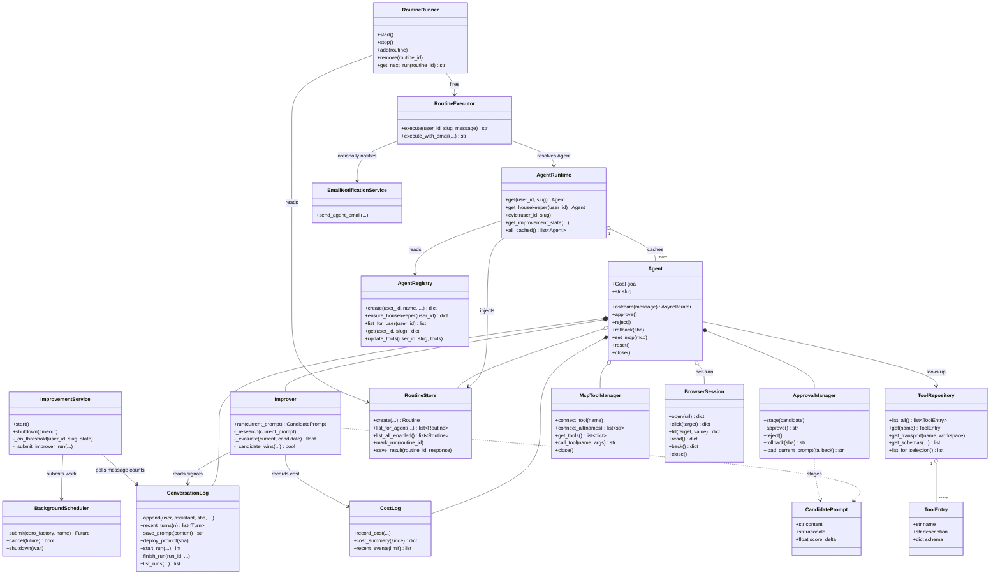

# τέλος

Persistent, goal-oriented AI agents for any long-standing personal task.

Each agent has a dedicated purpose, learns from your interactions, improves its own prompts over time, and can run scheduled routines autonomously.

---

## v1.0.0 — what's in this release

The first stable cut. Telos has grown from "single-agent chat with memory" into a small operating system for personal AI:

**A team you actually own**

- A meta-agent (the Housekeeper, ταμίας) routes work to specialists. Specialists can consult each other (`coordinate`, `list_agents`, `agent_status`) but only the Housekeeper can delegate full tasks or hire new agents. Cycles are blocked structurally so peer-to-peer chains can't deadlock.
- Each agent has a generated, goal-tailored system prompt and its own tool allowlist.

**Self-improvement, made auditable**

- Every chat turn feeds quality signals (corrections, follow-ups, ignores) into an improvement loop that researches, proposes, and judges new prompts.
- Every improvement run is now persisted — including no-op outcomes — and surfaced at `/agents/<slug>/improvements` with rationale, score delta, and a server-rendered diff. Improver costs are linked back to the run.

**Memory you can see**

- Every chat turn shows what Recordatio recalled. Click the briefing chip (or "View recalled memories") and a drawer opens with the actual semantic / episodic / procedural / entity units, plus resolved entities and relation triples.
- Recordatio persists briefing events to a sidecar SQLite and exposes `/v1/briefing-events/{request_id}`; Telos correlates each turn to its briefing.

**Cost transparency**

- Per-agent cost ledger in its own `costs.db` (separate from chat history — clearing the conversation never wipes spend).
- Cross-agent rollup at `/usage`.
- Recordatio-side cost dashboard at `/costs` with breakdowns by kind (chat vs extraction), model, agent, and a 24h / 7d / 30d / all range selector. Cache-aware pricing — cache reads bill at 10%, cache writes at 125%.
- Three independent API keys: `CHAT_API_KEY`, `IMPROVER_API_KEY`, and `RECORDATIO_EXTRACTION_API_KEY`, so spend per concern is visible at the provider too.

**Production-ready deployment**

- DuckDNS + Caddy automatic-HTTPS reverse proxy, Docker Compose with a `prod` profile.
- Recordatio dashboard exposed at `https://<host>/recordatio/*` behind Caddy basic-auth (Recordatio itself has no auth — the gate prevents your memory store from being world-readable).
- Idempotent deploy script with Caddy bind-mount inode-refresh handling.
- Sandboxed code execution (ripgrep + bubblewrap + socat) shipping in the image.

**Property + travel adapters**

- Site-adapter framework with Rightmove, Zoopla, and Airbnb adapters wired into `web_fetch` enrichment so listing pages return structured fields instead of rendered HTML.

**Polish + integrations**

- Google Drive / Docs / Sheets per-user OAuth.
- PWA with iOS/Android install + dark/light mode.
- Per-user email notifications via SMTP for routine results.
- PDF + image upload (vision-enabled).
- Anthropic prompt caching wired end-to-end (Telos → Recordatio → Pontifex) with cache-aware cost accounting.
- MCP tools (filesystem + GitHub).

## Architecture

Telos sits on top of a three-layer stack. Each layer has one job and one job only —
agents and tools live in Telos, memory and knowledge extraction live in Recordatio,
provider routing lives in Pontifex.

### System

End-to-end request flow from the PWA through Telos, Recordatio, and Pontifex out
to the LLM providers, plus the SQLite stores and APScheduler-driven side
channels owned by Telos.



> **Click any box** to jump to the source file or repo. Renders inline on
> GitHub; if you're reading this on a viewer that doesn't support Mermaid, see
> the layer-by-layer prose below.

### Classes

Main Python classes inside the `telos/` package and how they compose. `Agent`
owns the chat loop and the per-agent SQLite sub-systems; `AgentRuntime` is the
per-user cache that the FastAPI singletons in `api/app.py` hand to routes via
the dependency providers in `api/deps.py`.



**Telos** owns agents, tools, the UI, and self-improvement. It speaks plain
OpenAI-compatible chat-completions to Recordatio and tags every request with
`x-agent-id` so memories are namespaced per agent.

**Recordatio** ([`pasinit/recordatio`](https://github.com/pasinit/recordatio)) is a
transparent HTTP proxy. Telos sees a normal LLM endpoint; the proxy injects a
briefing on the way in, observes the stream on the way out, and extracts typed
knowledge units after the turn. The agent's code never calls `memory.add()` —
the memory layer owns relevance.

**Pontifex** ([`pasinit/pontifex`](https://github.com/pasinit/pontifex)) is the
routing primitive Recordatio builds on. One streaming interface, OpenAI SSE as the
canonical format, Anthropic converted internally. No memory, no orchestration,
no middleware — just the bridge.

**Side channels.** Three independent API keys give per-concern billing visibility:
`CHAT_API_KEY` (Telos → Recordatio → provider), `IMPROVER_API_KEY` (Telos calls
provider directly for the self-improvement loop, bypassing Recordatio), and
`RECORDATIO_EXTRACTION_API_KEY` (Recordatio's background extractor). The Recordatio
dashboard is exposed at `https://<host>/recordatio/*` behind Caddy basic-auth so
the memory store isn't world-readable.

## Tools

| Tool | Description |
|---|---|
| `web_search` | Search via Gemini Grounding, SerpAPI, or DuckDuckGo |
| `web_fetch` | Fetch URL content as plain text; site adapters enrich Rightmove / Zoopla / Airbnb listings |
| `browse` | Multi-step browser sub-agent (Playwright) for tasks beyond a single fetch |
| `browser_open` / `browser_click` / `browser_fill` / `browser_read` / `browser_back` | Imperative browser control |
| `python_exec` | Sandboxed Python execution (30s, no network) |
| `shell_exec` | Sandboxed shell execution (30s, no network) |
| `drive_search`, `gdocs_read`, `gdocs_append`, `gsheets_list_tabs`, `gsheets_read`, `gsheets_append`, `gsheets_update` | Per-user Google Drive / Docs / Sheets via OAuth |
| `send_email` | Send mail via the configured SMTP server |
| `create_routine`, `list_routines`, `delete_routine` | Scheduled recurring tasks |
| `coordinate`, `list_agents`, `agent_status` | Specialists consult peers and inspect the team |
| `delegate_to`, `create_agent` | Housekeeper-only — full task handoff and hiring |
| `mcp:filesystem`, `mcp:github` | MCP tools for files and GitHub |

## Setup

### Prerequisites

- Python 3.11+
- [Recordatio](https://github.com/pasinit/recordatio) running (LLM proxy + memory)

### Local development

```bash
make install        # Python deps
make web-install    # SPA deps (first time only)
# Edit .env with your keys
make aspire         # optional trace UI on :18888, OTLP on :4317/:4318
make recordatio        # start Recordatio on :8787 (separate terminal)
make dev            # one command: FastAPI on :7433 + Vite on :5173 (Ctrl+C kills both)
```

Open `http://localhost:5173` for the Vite dev server (HMR + proxy to FastAPI).
`make run` starts the FastAPI backend alone — it'll serve `telos-web/dist/` if
you've built it (`make web-build`), otherwise the API is reachable but the SPA
shell isn't served.

To send local traces to Aspire before `make dev`, export:

```bash
export OTEL_EXPORTER_OTLP_ENDPOINT=http://localhost:4317
export OTEL_SERVICE_NAME=telos
export VITE_OTEL_EXPORTER_OTLP_ENDPOINT=http://localhost:4318/v1/traces
export VITE_OTEL_SERVICE_NAME=telos-web
```

Open the trace dashboard at `http://localhost:18888`.
If you want the same trace to continue through Recordatio, start Recordatio in its
own terminal with `OTEL_EXPORTER_OTLP_ENDPOINT=http://localhost:4317` and
`OTEL_SERVICE_NAME=recordatio` as well.

`make aspire` and `make jaeger` bind their tracing ports to `127.0.0.1` and
allow browser OTLP CORS only from `http://localhost:5173` and
`http://127.0.0.1:5173` by default. For another trusted local frontend origin,
start the collector with:

```bash
export OTEL_BROWSER_CORS_ALLOWED_ORIGINS=https://dev-telos.example.com
make aspire
```

For production browser traces, do not expose Jaeger/Aspire with wildcard CORS.
Build the SPA with a controlled collector/proxy endpoint, preferably same-origin
such as `VITE_OTEL_EXPORTER_OTLP_ENDPOINT=/otlp/v1/traces`, and have the HTTPS
proxy forward only that path to the collector's OTLP HTTP `/v1/traces` endpoint.
Backend services can still export OTLP/gRPC directly on the private Docker
network or host-local port.

Example Caddy shape for a production collector named `otel-collector`:

```caddy
handle /otlp/v1/traces {
	request_body {
		max_size 1MB
	}
	uri strip_prefix /otlp
	reverse_proxy otel-collector:4318
}
```

### Docker

```bash
# Set GITHUB_TOKEN for private dependencies
export GITHUB_TOKEN=your_token
# Linux Docker host: load the confined namespace/mount policy first.
sudo install -m 0644 deploy/telos-sandbox.apparmor /etc/apparmor.d/telos-sandbox
sudo apparmor_parser -r /etc/apparmor.d/telos-sandbox
make docker-build
make docker-up

# Production with Caddy + HTTPS
make prod-up
```

The Telos container runs `python_exec` and `shell_exec` through
`sandbox-runtime`/bubblewrap inside a child user namespace. Compose drops all
outer capabilities except `SETFCAP` (needed to map UID 0), enables
`no-new-privileges`, keeps the existing unconfined seccomp setting, and loads
`telos-sandbox` AppArmor policy. It does not grant `SYS_ADMIN` or `NET_ADMIN`.
Workspace writes are allowed; the sandbox still isolates the network and makes
the rest of its filesystem read-only. `SANDBOX_ENABLE_NESTED=1` enables this
namespace setup. Both deployment paths install/reload the profile before startup.

For Docker Desktop VMs without AppArmor, skip the two `sudo` commands and set
`COMPOSE_FILE=docker-compose.yml:docker-compose.desktop.yml` before the Make
commands (Compose >=2.24.4). This override only omits the unsupported AppArmor
profile; it retains user namespaces, dropped capabilities and no-new-privileges.
Do not use it on the production Linux host.

Real Chromium regression checks (after `patchright install chromium`):

```bash
TELOS_BROWSER_SMOKE=1 .venv/bin/python -m unittest discover -s tests -p test_jobber_browser_integration.py -v
```

`tests/test_jobber_sandbox_integration.py` is also opt-in: run with
`TELOS_SANDBOX_SMOKE=1` in a **disposable** Linux container using the Telos image,
the Compose capabilities/security options and no production volumes or secrets.
It checks Python/shell execution, workspace writes, denied outside writes,
loopback network isolation and timeout cleanup.

### Environment variables

```env
# LLM routing (via Recordatio)
RECORDATIO_URL=http://localhost:8787
MODEL=anthropic/claude-sonnet-4-6

# LLM keys — three independent billing buckets
CHAT_API_KEY=sk-ant-...            # main chat traffic (Telos→Recordatio→provider)
IMPROVER_API_KEY=sk-ant-...        # auto-improvement loop (Telos→provider direct)
# Memory extraction key lives in Recordatio's own .env as RECORDATIO_EXTRACTION_API_KEY

# Search (pick one)
SEARCH_ENGINE=gemini          # gemini (default), serper, serpapi, duckduckgo, bing
GOOGLE_API_KEY=...            # for gemini
SERPAPI_KEY=...               # for serpapi

# Prompt generation
PROMPT_GEN_MODEL=claude-sonnet-4-6
PROMPT_GEN_BACKEND=anthropic

# Email notifications (optional)
SMTP_HOST=smtp.resend.com
SMTP_PORT=587
SMTP_USER=resend
SMTP_PASSWORD=re_...
SMTP_FROM=telos@yourdomain.com
BASE_URL=http://your-server:7433

# Google Docs / Sheets integration (optional, per-user OAuth)
GOOGLE_OAUTH_CLIENT_ID=...
GOOGLE_OAUTH_CLIENT_SECRET=...
GOOGLE_OAUTH_REDIRECT_URI=https://your-server/oauth/google/callback

# Production HTTPS (Caddy)
PUBLIC_HOST=telos.example.com
RECORDATIO_PASSWORD_HASH=$2a$14$...     # bcrypt hash for /recordatio/* basic-auth (use `make recordatio-hash PASS=...`)

# Local browser OTLP CORS override for `make aspire` / `make jaeger` (optional)
OTEL_BROWSER_CORS_ALLOWED_ORIGINS=http://localhost:5173,http://127.0.0.1:5173
```

### Google Docs / Sheets setup

Each Telos user connects their own Google account from `/profile`. To enable
the flow, the deployer creates one OAuth client and configures it once:

1. **Google Cloud Console**: create a project → APIs & Services → enable
   the **Drive API**, **Docs API**, and **Sheets API**.
2. **Credentials → Create Credentials → OAuth 2.0 Client ID** of type
   **Web application**. Set the authorised redirect URI to exactly the
   value of `GOOGLE_OAUTH_REDIRECT_URI` from `.env` (e.g.
   `https://telos.example.com/oauth/google/callback`).
3. **OAuth consent screen** → add the four scopes the integration uses:
   - `https://www.googleapis.com/auth/drive.metadata.readonly`
   - `https://www.googleapis.com/auth/documents`
   - `https://www.googleapis.com/auth/spreadsheets`
   - `openid` and `email` (for surfacing the connected account)
4. Copy the client ID and secret into `.env` as the two values above.
5. Restart Telos. The "Connect Google" button now appears on `/profile`.

Per-user refresh tokens are stored in `~/.telos/registry.db`
(`user_settings.google_refresh_token`).

## Deployment

Push to `main` triggers GitHub Actions deploy to DigitalOcean:

1. SSH into the droplet
2. Pull both Telos and Recordatio repos
3. Detect Caddyfile changes and force-recreate Caddy if needed (file-bind-mount inode refresh)
4. `docker compose build && docker compose up -d`

Required GitHub secrets: `DEPLOY_HOST`, `DEPLOY_USER`, `DEPLOY_SSH_KEY`.

The `prod` Compose profile adds Caddy. Set `PUBLIC_HOST` and `RECORDATIO_PASSWORD_HASH`
in `.env` and run `make prod-up` (or let the deploy script do it).

## Project structure

Layered Python package (`core → domain → transport → services → api`, one-way imports enforced by `import-linter`):

```
telos/
├── agent.py                 # Agent class, tool execution, streaming, peer coordination
├── goal.py                  # System prompt + tool selection generation
├── housekeeper.py           # Meta-agent (ταμίας) defaults — registry-seeded
├── improver.py              # Self-improvement pipeline (research → judge), run history
├── approval.py              # Prompt staging, approval, rollback
├── routines.py              # Scheduled tasks (APScheduler)
├── signals.py               # Quality signal detection (regex + Haiku)
├── log.py                   # Conversation log + improvement_runs (SQLite)
├── costs.py                 # Per-agent cost ledger (separate from history)
├── pricing.py               # Local price table fallback for cost_for()
├── browser.py               # Browser session / multi-step tools
├── adapters/                # Site adapters (Rightmove, …)
├── google_api.py            # Drive / Docs / Sheets helpers
├── google_auth.py           # Per-user Google OAuth flow
├── mailer.py                # SMTP email
├── mcp.py                   # MCP tool connections
├── tools.py                 # Tool repository (single source of truth)
├── core/                    # Persistence repos (SQLite — registry, turns, routines)
├── domain/                  # Pure-data models, tool contracts
├── transport/               # LLM / browser / search adapters
├── services/                # AgentRuntime, ImprovementService, BackgroundScheduler,
│                            #   CostRollupService, EmailNotificationService, …
└── api/                     # FastAPI JSON app (post-Phase-7)
    ├── app.py               # Factory + lifespan + module-level singletons
    ├── deps.py              # current_user, agent_runtime, … (FastAPI deps)
    ├── settings.py          # Settings (env-driven)
    ├── registry.py          # AgentRegistry — UI-side wrapper around core.repos
    ├── spa.py               # Static-mount + catch-all for telos-web/dist/
    ├── auth/                # Cookie + Bearer token helpers
    └── routes/              # auth, agents, chat (SSE), settings_page,
                             #   improvements, costs, routines, google_oauth, memories
```

The Svelte SPA lives next to the Python package:

```
telos-web/
├── CONVENTIONS.md           # Required reading before adding a page
├── package.json, vite.config.ts, tsconfig.json
├── public/                  # manifest.webmanifest, icons (PWA install assets)
└── src/
    ├── App.svelte           # Router + Shell host
    ├── routes.ts            # Route table (svelte-spa-router)
    ├── app.css              # Global styles (Tailwind CDN + ported base styles)
    ├── lib/
    │   ├── api.ts           # Shared fetch wrapper with auth injection + ApiError
    │   ├── auth.ts          # currentUser store + login/logout/loadMe
    │   ├── sse.ts           # fetch+ReadableStream helper for chat SSE
    │   ├── markdown.ts      # marked + DOMPurify
    │   └── stores/          # Svelte stores (agents, improvements, theme)
    ├── components/
    │   ├── Shell.svelte     # Sidebar + drawer + header (composed by every page)
    │   ├── Chat/            # Chat, MessageBubble, ToolDisplay, RecordatioDrawer, …
    │   ├── Settings/        # CurrentPromptPanel, ToolsPicker, PromptHistoryPanel, …
    │   ├── Routines/        # RoutinesPanel
    │   ├── Improvements/    # Per-page panels
    │   ├── Usage/           # RangePills, AgentSpendBar, AgentAccordion, …
    │   └── common/          # Toast
    └── pages/               # Login, Profile, Housekeeper, ChatPage,
                             # AgentsIndex, AgentSettings, Improvements, Usage, NotFound
```

The backend ships the built SPA from `telos-web/dist/` (mounted by `api/spa.py`). The Dockerfile is multi-stage: Node builds the SPA in stage 1, Python runtime copies the dist tree in stage 2.

## How it works

1. **Agent creation** — user provides a name and goal. An LLM generates a tailored system prompt and selects appropriate tools (excluding housekeeper-only ones).
2. **Chat** — messages stream through Recordatio (which retrieves and injects memory context as a briefing) to the LLM. Tool calls execute concurrently. The Svelte client renders the incremental Markdown stream via `marked` + DOMPurify. Each turn captures Recordatio's `request_id` so its briefing can be looked up later.
3. **Signal detection** — each user message is classified (regex + async Haiku) as correction, follow-up, or ignored. Signals feed the improvement loop.
4. **Self-improvement** — every N turns, an agentic Claude call researches conversation quality, proposes a better prompt, and an LLM judge evaluates it. Candidates with >1% improvement auto-deploy. Every run — including no-op outcomes — is persisted with rationale, decision, and diff.
5. **Routines** — agents propose scheduled tasks, user confirms via a UI pill. APScheduler fires them on schedule, results save to chat and optionally email. Missed routines execute on restart.
6. **Peer coordination** — the Housekeeper delegates whole tasks to specialists; specialists `coordinate` with each other for consultation. Cycle detection via `contextvars.ContextVar` prevents A→B→A deadlocks.

## License

MIT.

## Codex subscription runtime

Telos selects Claude (Claude Code subscription) by default; Codex remains
selectable with `TELOS_SUBSCRIPTION_PROVIDER=codex`.
See [Codex migration](CODEX_MIGRATION.md) for authentication, model selection,
Recordatio extraction, and deployment checks.

### Routine tool reliability and evaluation

The Telos MCP host scopes browser state to the authenticated user, agent, and
`X-Telos-Turn-Id` header. Both Claude and Codex receive this per-turn header;
browser calls in one turn share a page, and image results remain MCP image
content. Telos closes the session when the turn ends, with an idle reaper as a
fallback. Existing URL restrictions and tool allowlists still apply.

Tool arguments and results, priority retrieval, and routine email bodies and
SMTP acceptance are stored beside each turn in its agent's `history.db`.
Credential fields and image data are excluded; oversized evidence is explicitly
marked as truncated. Nightly evaluation reads this evidence and reports
`task_completion` separately from its response-quality score. Historical turns
without evidence remain evaluable but cannot establish tool or email success.

`ROUTINE_RECALL_QUERIES` optionally reserves up to three production memory
queries for a specific `user/agent` scope, for example:

```dotenv
ROUTINE_RECALL_QUERIES={"owner/jobber":["submitted applications and subsequent status updates"]}
```

Retrieved records retain their dates and conflicting content, with a 12,000
character context budget. Retrieval failures and truncation are exposed to the
agent. This is opt-in and does not change global memory ranking.

Set `SEARCH_ENGINE=duckduckgo` when Serper credits are unavailable. If Serper is
selected and reports exhausted credits, searches use the existing DuckDuckGo
fallback for one hour before retrying Serper. A confirmed `send_email` tool call
to the routine recipient suppresses the automatic duplicate notification.

The free search path tries Bing, Brave, DuckDuckGo and Yahoo independently, with
serialized, paced requests and a short cooldown after provider failures. It
filters ad redirects and enforces explicit `site:`/`-site:` restrictions. A
query with no extracted hits does not disable that provider for other queries.
Free providers can still block or rate-limit access; failure is not evidence of
zero vacancies. A provisioned `SERPAPI_KEY` with `SEARCH_ENGINE=serpapi` is an
alternative, with the free path retained as fallback. No paid provider is
silently enabled by the free-search setting.

Set `SEARCH_ENGINE=bing` for Bing-only searches through DDGS, without an API
key. This mode deliberately does not fall back to other search engines when
Bing fails, so a Bing trial measures Bing rather than a hidden fallback. The
setting applies to generic `web_search` for all agents; direct property-site
connectors are unchanged. This is not a Microsoft Bing Search API integration.

Browser tools follow visible controls and new tabs, and extract PDF attachment
text in a bounded child process. Long pages and PDFs expose `next_offset`; pass
it to `browser_read` until it is absent. Unsupported, scanned/password-protected
or oversized documents report errors, not missing eligibility requirements.
PDF parsing limits are 20 MiB, 200 pages and 500,000 characters, with a 15-second
parse timeout; the browser download has a separate 30-second timeout. The size
limit is checked after download. HTML is capped at 500,000 characters with an
explicit truncation warning. External 403/406 responses remain access failures.

### Isolated nightly coding worker (Linux)

On Linux Docker hosts, the nightly implementer can run in a separate worker
using the same Telos image. The API prepares disposable Git clones in the
`nightly-work` volume, sends an authenticated internal HTTP request, and records
the returned PRs and skips. Verification installs the locked runtime plus dev/UI
dependencies in a fresh venv and keeps test data inside the clone. A GitHub-scoped
credential helper permits installing the private Pontifex dependency without
writing the token to clone URLs or credential files. The worker has no production-data mounts, source
checkout mounts, Docker socket, or published port. It receives only the GitHub
credential and provider login needed for coding. Both `codex` and `claude`
remain selectable through `TELOS_SUBSCRIPTION_PROVIDER`; model selection is
unchanged. An unavailable worker fails the run without switching providers.

To enable on the deployment host:

1. Install `deploy/telos-nightly.apparmor` as
   `/etc/apparmor.d/telos-nightly` and load it with `apparmor_parser -r`.
2. Set `COMPOSE_PROFILES=prod,nightly-worker`,
   `NIGHTLY_WORKER_URL=http://nightly-worker:7444`, and a random
   `NIGHTLY_WORKER_TOKEN` of at least 32 characters in `.env`.
3. Run `docker compose build && docker compose up -d`. Both deployment paths
   reload the worker's AppArmor profile before starting containers. Keeping
   the profile in `/etc/apparmor.d` also loads it after a host reboot.

The worker uses its own namespace/mount policy and unmasked proc paths
required by bubblewrap. Its AppArmor profile denies sensitive kernel paths;
its root filesystem is read-only, all capabilities except SETFCAP (needed for
mapping UID 0) are dropped, and no-new-privileges is enabled. The existing
Codex login volume is reused; no API billing fallback is configured. The
worker's HTTP credential is removed from its environment before spawning CLI
children. Claude uses its existing agent harness and OAuth credential.

Before a Codex model turn, the worker actually creates a file and Git commit
through `command/exec` with workspace-write policy, and checks that an outside
write is denied. This detects broken isolation without spending a model turn.
Execution is bounded, one job runs at a time, and disconnects/cancellations
terminate its CLI process. If termination cannot be confirmed after a transport
failure, the API preserves that job directory instead of removing files under
a possibly running process; an operator can remove it once the worker stops.
No production container or host-wide AppArmor restrictions are disabled.

Without `NIGHTLY_WORKER_URL`, local CLI execution remains available with the
same Codex preflight and existing Claude implementation.
