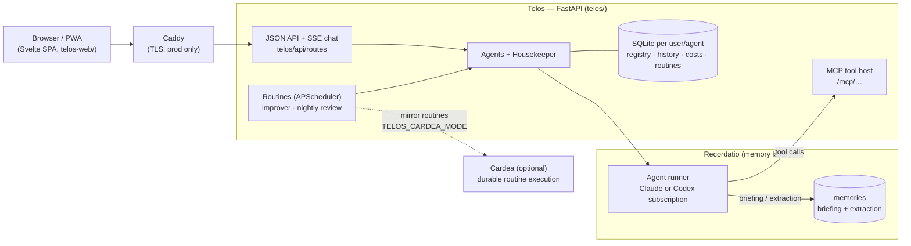

# τέλος (Telos)

Telos is a self-hosted platform for persistent, goal-oriented AI agents that handle
long-running personal tasks — research, monitoring, recurring reports. It is for a single
owner (or a small household) who wants agents that remember, run on a schedule, and
improve their own prompts over time.

Each agent has one goal, its own tool allowlist and generated system prompt. A meta-agent,
the Housekeeper (ταμίας), routes work to specialists and can hire new ones.

## Architecture



- **Telos** owns agents, tools, routines, the UI, cost tracking and self-improvement.
- **[Recordatio](https://github.com/pasinit/recordatio)** runs each model turn: it injects a
  memory briefing, streams the turn back, and extracts knowledge afterwards. Agent tools are
  served back to it by Telos's MCP host. Telos itself never calls `memory.add()`.
- **[Cardea](https://github.com/pasinit/cardea)** is where scheduled routines are moving. With
  `TELOS_CARDEA_MODE=shadow|live`, `telos/cardea_bridge.py` mirrors routines to Cardea
  triggers; the operations Cardea may call live in [`packages/telos-cardea`](packages/telos-cardea/).

The Python package is layered `core → domain → transport → services → api`; `make lint-imports`
enforces the one-way imports.

## What an agent can do

| Area | Tools |
|---|---|
| Web | `web_search`, `browser_open` / `_click` / `_fill` / `_read` / `_back` |
| Code | `python_exec`, `shell_exec` (sandboxed with bubblewrap, no network) |
| Google | `drive_search`, `gdocs_read` / `_append`, `gsheets_list_tabs` / `_read` / `_append` / `_update` (per-user OAuth) |
| Memory | `memory_recall` |
| Routines & email | `create_routine`, `list_routines`, `delete_routine`, `send_email` |
| Team | `coordinate`, `list_agents`, `agent_status`; Housekeeper only: `delegate_to`, `create_agent` |
| Property search | `rightmove_search`, `zoopla_search`, `agency_search`, `record_property_assessment`, `list_property_candidates` |
| MCP | `mcp:filesystem`, `mcp:github` |

Every chat turn records quality signals (corrections, follow-ups, ignores). After
`IMPROVE_EVERY` new messages an improver proposes a better prompt, a judge scores it, and each
run is shown at `/agents/<slug>/improvements` with its rationale and diff.

## Quickstart (local)

Requires Python 3.13, Node, and a [Recordatio](https://github.com/pasinit/recordatio) checkout
next to this one (`../recordatio`). One Python dependency is installed from a private Git
repository, so `make install` needs GitHub credentials with access to it.

```bash
make install        # .venv with [dev,ui] extras
make web-install    # SPA dependencies
touch .env          # then add the settings below
make recordatio     # Recordatio on :8787 (separate terminal)
make dev            # FastAPI on :7433 + Vite on :5173
```

Open http://localhost:5173. `make run` starts only the backend, serving `telos-web/dist/`
once built with `make web-build`.

## Configuration

Read from the environment or `.env` (`telos/api/settings.py`). The essentials:

| Variable | Default | Purpose |
|---|---|---|
| `RECORDATIO_URL` | `http://localhost:8787` | Recordatio endpoint |
| `TELOS_SUBSCRIPTION_PROVIDER` | `claude` | `claude` or `codex` — see [CODEX_MIGRATION.md](CODEX_MIGRATION.md) |
| `CODEX_MODEL` | empty (CLI default) | Codex model pin |
| `STORAGE_ROOT` | `~/.telos` | SQLite stores |
| `SEARCH_ENGINE` | `gemini` | `gemini` (`GOOGLE_API_KEY`), `serper` (`SERPER_KEY`), `serpapi` (`SERPAPI_KEY`), `duckduckgo`, `bing` |
| `SMTP_HOST`, `SMTP_PORT`, `SMTP_USER`, `SMTP_PASSWORD`, `SMTP_FROM` | — | Routine emails |
| `BASE_URL` | — | Public URL used in email links and by Recordatio to reach `/mcp` |
| `GOOGLE_OAUTH_CLIENT_ID`, `_SECRET`, `_REDIRECT_URI` | — | Google Docs/Sheets ([setup](docs/deployment.md#google-docs--sheets)) |
| `TELOS_CARDEA_MODE` | `off` | `off`, `shadow` or `live` routine mirroring to Cardea |
| `OTEL_EXPORTER_OTLP_ENDPOINT` | — | Enable tracing (`make aspire` or `make jaeger`) |

Nightly review, synthesizer and implementer flags (`NIGHTLY_*`) are off by default; see
`telos/api/settings.py`.

## Development

```bash
make test           # pytest
make lint-imports   # layer contracts
make web-check      # svelte-check
make web-test       # SPA unit tests
make cardea-ops-check   # packages/telos-cardea (own uv venv)
```

UI changes: run `make dev` and try them in the browser. Frontend rules are in
[telos-web/CONVENTIONS.md](telos-web/CONVENTIONS.md).

## More

- [docs/deployment.md](docs/deployment.md) — Docker, sandbox, HTTPS, tracing, nightly worker, Google OAuth
- [CODEX_MIGRATION.md](CODEX_MIGRATION.md) — switching between Claude and Codex subscriptions
- [docs/real_estate_agents_xhr.md](docs/real_estate_agents_xhr.md) — estate-agent search adapters
- [docs/homey/](docs/homey/) — example agent prompt and routine for property search
- [docs/architecture/REDESIGN.md](docs/architecture/REDESIGN.md) — historical design for the layered package

## License

MIT.
