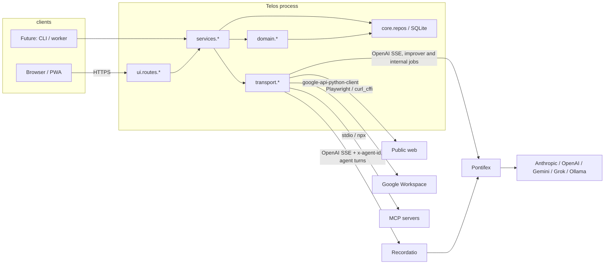
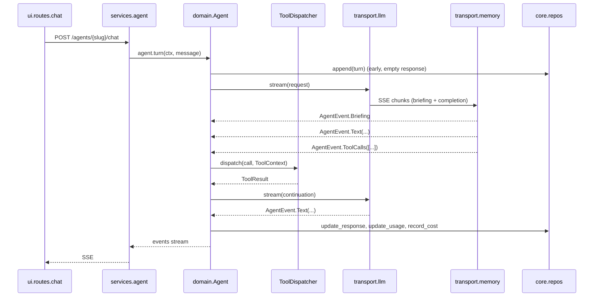
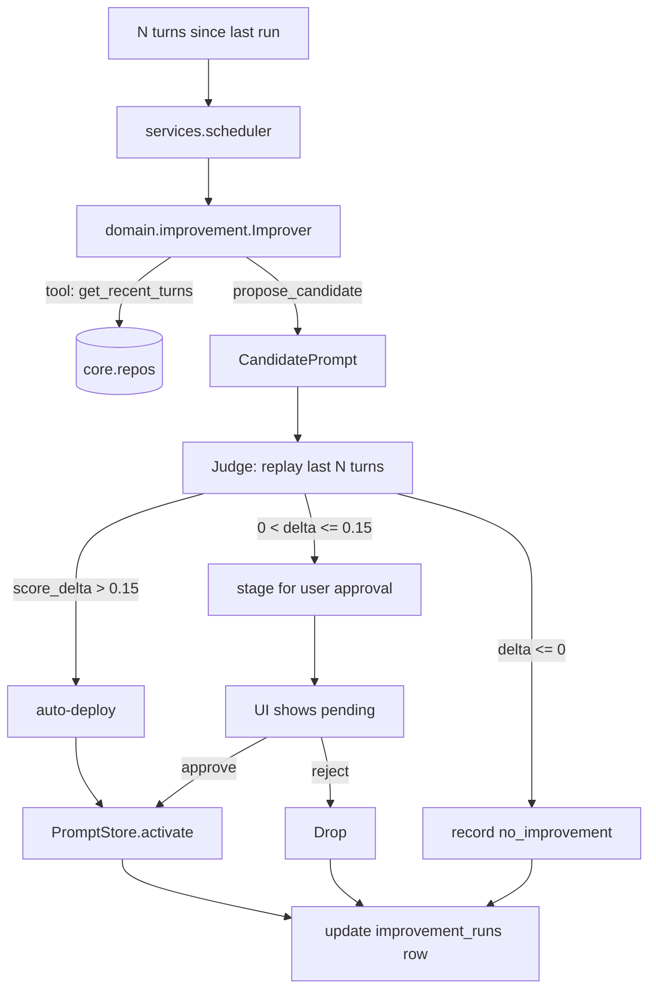
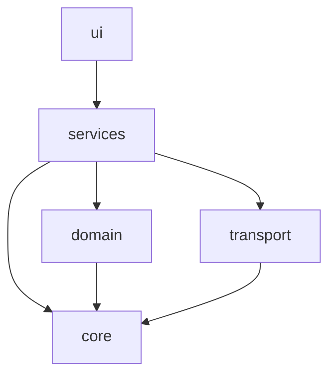

# Telos — Architecture Redesign

Status: proposal • Author: senior-architect review pass • Target: telos v2.x

## 1. Executive summary

- **`telos/agent.py` (1982 LOC) is a god-module.** It conflates HTTP fetching, image extraction, search-engine routing, sandboxed shell, the OpenAI streaming protocol, the agent state machine, tool dispatch, peer delegation, cost accounting, signal classification, history truncation, prompt locking, and improvement scheduling. Split into ~7 modules with one job each.
- **`telos/ui/server.py` (1452 LOC) is the second god-module.** A FastAPI module that mixes auth, OAuth, settings, agent lifecycle, SSE streaming, cost rollups, tool grouping, routine REST, and template rendering. Split into route packages by concern; pull non-HTTP logic into a service layer.
- **The `Agent` class is a service locator with setter-injection of private attributes.** `server.py` writes `agent._registry`, `agent._get_agent_fn`, `agent._google_oauth_client_id`, `agent._google_oauth_client_secret` after construction; `_execute_tool` reaches into them. Replace with a `RunContext` value-object passed per turn.
- **Three SQLite stores per agent (`history.db`, `costs.db`, `routines.db`) with ad-hoc schema migrations and no shared connection management.** Centralise persistence behind small repository interfaces; co-locate migrations.
- **Tool dispatch is a 350-line `if/elif` ladder with eight side-channel parameters.** Replace with a `ToolHandler` protocol and per-tool registration. The current "tool repository" is a schema catalogue only — make it own execution too.
- **Recordatio integration is implicit.** The agent stream parses `agentmem.briefing` and `agentmem.usage` events inline. Hide that under a `RecordatioTransport` type so the agent state machine doesn't know which provider it talks to.
- **Improvement loop is wired into the chat hot path** (`Agent._astream_body` calls `Improver.run_async`). Move to a `JobScheduler` so the chat coroutine doesn't own background threading semantics.
- **Style violations are universal:** every module carries `from __future__ import annotations` despite the project policy in `CLAUDE.md` forbidding it on Python ≥ 3.11. Removing it is part of every refactor pass.
- **Dead reference / build hazard:** `telos/agent.py:730` imports `from .browse import browse` but `telos/browse.py` is not in the source tree (only the `.pyc` exists). The `browse` tool will fail at runtime in any clean checkout. Surfaced by file enumeration.
- **Goal:** a layered package (`core` → `services` → `transport` → `ui`) with explicit ports for Recordatio, the LLM SDK, persistence, tools, and the scheduler. Improves testability (today, unit tests exercise SQLite + threads + async); enables alternative front-ends (CLI, websockets, headless workers) without touching agent code.

## 2. Current state assessment

### 2.1 Top structural problems

| # | Problem | Evidence |
|---|---|---|
| 1 | God-module `agent.py` mixes 7+ concerns | `telos/agent.py:64–660` (HTTP/sandbox/search/image helpers) sit in the same file as `class Agent` (`:1109`); 1982 LOC total |
| 2 | God-module `ui/server.py` mixes routes, services, glue, templates | `telos/ui/server.py:1–1452`; 36 routes + agent factory + cost rollups + tool grouping + Recordatio proxy in one file |
| 3 | `Agent` is constructed half-built, then mutated by callers | `telos/ui/server.py:321–324, 366–369` set `_registry`, `_get_agent_fn`, `_google_oauth_*` on a fully-constructed `Agent`. No type system enforces that these are present before `astream` runs |
| 4 | UI reads agent privates (`_costs`, `_log`, `_slug`) directly | `telos/ui/server.py:548, 654, 795, 828, 854`. The "public surface" is fictional |
| 5 | Tool dispatch is a 350-line `if/elif` with 9 keyword parameters | `_execute_tool(...)` `telos/agent.py:665–1023`. Adding a tool means editing the ladder *and* the `tool_repository` *and* the schema catalogue |
| 6 | Background threads + asyncio + signal classification share locks ad-hoc | `Agent._prompt_lock` (threading.Lock) + `_stream_lock` (asyncio.Lock) + `_active_agents` ContextVar; Improver runs on a daemon thread but writes via SQLite with `check_same_thread=False`. Correct, but fragile and repeated in three places |
| 7 | Module-level globals as control planes | ~~`_active_runner` in `telos/routines.py:381`~~ (resolved in Phase 5F — runner now flows via `AgentRuntime.routine_runner` and `ToolContext.routine_runner`); `_creds_cache` + `_creds_lock` in `telos/google_auth.py:105`; `_warned_unknown_models` in `telos/pricing.py:18`; `_gemini_backoff_until` in `telos/agent.py:547`; `_sandbox_initialized` in `telos/agent.py:583`. Prevents multi-tenancy, complicates testing, hides lifecycle |
| 8 | Persistence layer is ad-hoc per-feature | Three SQLite files per agent (`history.db`, `costs.db`, `routines.db`) with bespoke migrations (`telos/log.py:55–101`, `telos/routines.py:56–110`, `telos/costs.py:65–84`). No shared `Database` abstraction; no migration framework; ALTER TABLE in a `try/except: pass` block in three places |
| 9 | `goal.Goal` knows about the tool repository AND drives the LLM | `telos/goal.py:106–185` — combines prompt generation, tool selection LLM call, cost callback wiring. Belongs in a `services.AgentFactory` |
| 10 | Cycle-prevention via ContextVars is correct but undiscoverable | `_active_agents` in `telos/agent.py:54–56` is the only mechanism preventing A→B→A deadlocks. Belongs in a typed `DelegationGraph` so it's testable in isolation |
| 11 | Recordatio protocol is leaked into the chat loop | Streaming chunk parser in `_astream_body` (`telos/agent.py:1438–1464`) understands `agentmem.briefing` and `agentmem.usage`. The agent shouldn't need to know its provider runs a sidecar |
| 12 | `improver.py` opens its own Anthropic SDK client and bypasses Pontifex | `Agent.__init__` keeps `self._client = anthropic.Anthropic(...)` at `telos/agent.py:1199` only so it can be passed to `Improver`. Two problems: (a) the agent owning the SDK *for the improver* couples them; (b) bypassing Pontifex loses provider routing, failover, and unified cost tracking — the improver should go through Pontifex (not Recordatio — it doesn't want memory injection on its own analysis turns) |
| 13 | Style policy violation in 22 files | `from __future__ import annotations` in every module under `telos/` (per `CLAUDE.md` it should be removed when touching the file — but no PR has removed any) |
| 14 | Missing source file referenced in production code | `telos/agent.py:730` does `from .browse import browse as _browse`; `telos/browse.py` is not in the working tree |
| 15 | Server reads/writes the same SQLite file from multiple paths | `ConversationLog(settings.storage_root / uid / slug / "history.db")` is constructed in `server.py:548, 654, 977, 1012, 1196` and inside `Agent.__init__`. Bypasses any cache the agent might keep |
| 16 | ~~Dead code path / TODO surface~~ | ~~`_routines_mod._active_runner` global mutated from `server.py` at `:253, 258, 1221, 1372, 1392, 1422`. A scheduler dependency masquerading as a global~~ — resolved in Phase 5F: the back-channel is replaced by `telos.ui.app._routine_runner` (route reads) + `AgentRuntime.routine_runner` (lazy provider) + `ToolContext.routine_runner` (tool handler reads) |

### 2.2 Less critical but worth fixing

- `pricing.py` is a copy of a table that lives in Recordatio's source. Recordatio returns `cost_usd` on most requests already; the local table should be a fallback only and ideally fetched from Recordatio at startup.
- `signals.py` regex-classifies messages, then `Agent._classify_signals` re-classifies via Haiku 30 lines later. Keep one path; ideally Recordatio owns this since it observes every turn.
- `BrowserSession` in `telos/browser.py` lazy-imports from `telos.agent` at `:214` for image extraction (`_extract_images_from_html`, `_download_and_resize_image`). A circular dependency masked by a deferred import. Image utilities belong in a shared module.
- Templates (`chat.html` 996 LOC) carry significant client-side JS. Out of scope for this doc, but worth a `static/js/` extraction pass.

## 3. Design principles

In priority order. Items lower on the list yield to items higher up.

1. **One job per module.** A module's docstring should fit in one sentence and not contain "and".
2. **Dependency direction is one-way.** Lower layers (`core`, `domain`) cannot import higher layers (`transport`, `ui`). Enforced by ruff config + a small import-linter rule.
3. **Pure where possible, impure where necessary, side effects at the boundary.** State machine logic in `core` returns intents/events; effects (HTTP, DB writes, scheduler ticks) happen in `services` and are mocked in tests.
4. **Constructor-complete objects.** No setter-injection. If `Agent` needs a registry, take it in `__init__` (or via a `RunContext` per call). No half-built objects.
5. **Stable seams over clever code.** Prefer 4 small interfaces (LLM, Memory, Persistence, Scheduler) implemented twice (real + fake) over one clever abstraction.
6. **Persist intent, not state.** SQLite tables describe events (turns, cost events, improvement runs, routine fires) — not in-memory snapshots. Agents reconstitute their state from the event log on demand.
7. **Acknowledge the tradeoffs.** A layered design with explicit ports adds files. For a 7000-LOC project this is the right move; for a 700-LOC one it would not be.

## 4. Proposed architecture

Five layers. Strict import direction: lower may not import higher.

```
ui/        →  routes, templates, SSE serialisation
transport/ →  HTTP clients (Recordatio, Pontifex, Google), browser, MCP, SMTP
services/  →  AgentService, ImprovementService, RoutineService, CostService
domain/    →  Agent state machine, Goal, RunContext, signals, dispatch
core/      →  Persistence ports, IDs, time, tracing, settings primitives
```

### 4.1 Subsystem responsibilities and dependencies

| Subsystem | Single responsibility | Imports | Imported by |
|---|---|---|---|
| `core.persistence` | SQLite connection management, migrations, repository protocols | stdlib only | `core.repos`, all `services` |
| `core.repos` | `TurnRepo`, `PromptRepo`, `CostRepo`, `RunRepo`, `RoutineRepo`, `RegistryRepo` interfaces + SQLite impls | `core.persistence` | `services` |
| `core.ids` | Slugs, turn IDs, run IDs, request IDs (typed wrappers) | stdlib | everywhere |
| `core.settings` | Typed env settings, no I/O at import time | `pydantic-settings` | `services`, `transport`, `ui` |
| `domain.agent` | `Agent` aggregate: holds in-memory history, executes a turn as a state machine yielding events. No HTTP, no SQLite, no SDK calls — receives them via ports. | `core.repos`, `domain.tools`, `domain.signals` | `services.agent` |
| `domain.tools` | `ToolHandler` protocol; per-tool implementations as separate modules; `ToolDispatcher` chooses by name | `transport.*` (via DI), `core.repos` | `domain.agent`, `services.agent` |
| `domain.signals` | Pure regex + LLM signal classification (LLM call via port) | `core.ids` | `domain.agent` |
| `domain.improvement` | `Improver` state machine; plans research → judge → propose. Pure orchestration; LLM via port. | `core.repos`, `domain.signals` | `services.improvement` |
| `domain.delegation` | `DelegationGraph` + cycle detection. Replaces `_active_agents` ContextVar. | `core.ids` | `domain.agent` |
| `transport.llm` | LLM client interface. Two implementations: one over Recordatio (for agent turns — gets briefings + memory injection); one over Pontifex directly (for improver and other internal jobs that should NOT receive memory injection but still want provider routing + unified cost tracking) | `httpx` | `services` |
| `transport.memory` | `RecordatioClient`: briefing-events fetch + the `agentmem.briefing`/`agentmem.usage` parser | `httpx` | `services.agent` |
| `transport.browser` | `BrowserSession` (already exists); plus a `WebFetcher` that combines curl_cffi + playwright race | `patchright`, `curl_cffi` | `domain.tools.web` |
| `transport.search` | `SearchEngine` with implementations for Gemini/Serper/SerpAPI/DDG | `httpx`, `google-genai` | `domain.tools.web` |
| `transport.google_workspace` | OAuth flow + Drive/Docs/Sheets API | `google-api-python-client` | `domain.tools.google` |
| `transport.mcp` | `McpToolManager` (already exists, mostly OK) | `toolregistry` | `services.agent` |
| `transport.sandbox` | Sandboxed shell/python execution | `sandbox-runtime` | `domain.tools.code` |
| `transport.mailer` | SMTP send | stdlib | `services.notification` |
| `transport.adapters` | Site adapters (Rightmove, etc.) | `bs4` | `domain.tools.web` |
| `services.agent` | `AgentRuntime`: assembles `domain.Agent` with concrete ports, owns the per-(user, slug) cache, builds `RunContext` per request | all `transport` + all `domain` + `core.repos` | `ui` |
| `services.improvement` | `ImprovementService`: schedules runs, persists outcomes, exposes admin actions (approve/reject/rollback) | `domain.improvement`, `core.repos`, `services.scheduler` | `ui`, `services.agent` |
| `services.routine` | Wraps `RoutineRunner`; exposes start/stop/restore | `apscheduler`, `core.repos` | `ui` |
| `services.cost` | Aggregates per-agent and cross-agent cost summaries | `core.repos` | `ui` |
| `services.notification` | Routine emails, agent-emitted emails | `transport.mailer`, `core.repos` | `ui`, `services.routine` |
| `services.scheduler` | Generic background-job runner used by `ImprovementService` (replaces the daemon thread inside `Improver.run_async`) | stdlib (`concurrent.futures`) | `services.improvement` |
| `ui.app` | FastAPI factory, middleware, error handlers | `services.*` | entrypoint |
| `ui.routes.chat` | Chat page, SSE streaming, upload, status | `services.agent` | `ui.app` |
| `ui.routes.agents` | Create/list/delete/settings | `services.agent`, `core.repos` | `ui.app` |
| `ui.routes.routines` | Routine CRUD + activate/dismiss | `services.routine` | `ui.app` |
| `ui.routes.improvements` | Improvement history page + API | `services.improvement` | `ui.app` |
| `ui.routes.usage` | `/usage` rollup | `services.cost` | `ui.app` |
| `ui.routes.auth` | Login, logout, profile, Google OAuth | `transport.google_workspace`, `core.repos` | `ui.app` |
| `ui.sse` | SSE event serialisation, Markdown→HTML | `mistune` | `ui.routes.chat` |

### 4.2 Key interfaces (sketch)

```python
# core/repos.py
class TurnRepo(Protocol):
    def append(self, agent: AgentId, user_message: str, *, is_routine: bool) -> TurnId: ...
    def update_response(self, turn: TurnId, text: str) -> None: ...
    def update_usage(self, turn: TurnId, prompt: int, completion: int) -> None: ...
    def update_signals(self, turn: TurnId, signals: Signals) -> None: ...
    def recent(self, agent: AgentId, n: int) -> list[Turn]: ...

class CostRepo(Protocol):
    def record(self, event: CostEvent) -> None: ...
    def summary(self, agent: AgentId, since: datetime | None = None) -> CostSummary: ...

class LlmStream(Protocol):
    async def stream(self, req: LlmRequest) -> AsyncIterator[LlmEvent]: ...

class MemoryClient(Protocol):  # implemented by RecordatioClient
    async def briefing_for(self, request_id: str) -> Briefing | None: ...
```

```python
# domain/agent.py
class Agent:
    def __init__(self, *, goal: Goal, ports: Ports, prompt: PromptStore): ...
    async def turn(self, ctx: RunContext, message: str) -> AsyncIterator[AgentEvent]: ...

@dataclass(frozen=True)
class RunContext:  # passed per call, not stashed on the agent
    user_id: UserId
    request_id: RequestId
    image_url: str | None = None
    is_routine: bool = False
    delegation_graph: DelegationGraph
    correlation_id: TraceId
```

```python
# domain/tools.py
class ToolHandler(Protocol):
    name: ToolName
    schema: ToolSchema
    housekeeper_only: bool
    async def __call__(self, args: dict, ctx: ToolContext) -> ToolResult: ...

@dataclass
class ToolContext:
    user_id: UserId
    agent_id: AgentId
    workspace: Path
    deps: ToolDependencies   # llm, browser, search, mcp, google, mailer, registry
```

The 350-line `_execute_tool` ladder collapses into per-handler modules:
`domain/tools/web.py`, `domain/tools/code.py`, `domain/tools/google.py`,
`domain/tools/team.py`, `domain/tools/routines.py`, `domain/tools/adapter_dispatch.py`.

## 5. System diagrams

### 5.1 High-level component diagram



### 5.2 Agent turn — request flow



### 5.3 Self-improvement loop



### 5.4 Allowed import direction



Forbidden edges (would be linted): `domain → transport`, `domain → services`, `domain → ui`, `core → anything`, `transport → services`, `transport → ui`.

## 6. Module map

```
telos/
├── __init__.py                 # re-export public API surface from services
├── core/
│   ├── ids.py                  # NewType wrappers: UserId, AgentId, TurnId, RunId, RequestId
│   ├── settings.py             # Settings (was telos/ui/server.py:74-110)
│   ├── persistence.py          # SQLite connection factory, migrations runner
│   ├── time.py                 # `now_utc()` — testable clock
│   └── repos/
│       ├── __init__.py         # Protocols
│       ├── turns.py            # was telos/log.py (turns/prompts portion)
│       ├── runs.py             # was telos/log.py (improvement_runs portion)
│       ├── costs.py            # was telos/costs.py
│       ├── routines.py         # was telos/routines.py (RoutineStore portion)
│       └── registry.py         # was telos/ui/registry.py
├── domain/
│   ├── goal.py                 # dataclass-only Goal (no LLM call)
│   ├── prompt.py               # PromptStore (was telos/approval.py + parts of log.py)
│   ├── signals.py              # was telos/signals.py
│   ├── delegation.py           # DelegationGraph (replaces _active_agents)
│   ├── agent/
│   │   ├── __init__.py         # Agent class
│   │   ├── state.py            # turn state machine (events/intents)
│   │   ├── history.py          # in-memory history + token budgeting
│   │   └── ports.py            # Ports dataclass: llm, memory, repos, scheduler
│   ├── improvement/
│   │   ├── improver.py         # was telos/improver.py (research + judge)
│   │   └── candidate.py        # CandidatePrompt
│   └── tools/
│       ├── registry.py         # was telos/tools.py (schema portion only)
│       ├── dispatcher.py       # ToolDispatcher: name → handler
│       ├── web.py              # web_search, web_fetch, browser_*, browse
│       ├── code.py             # python_exec, shell_exec
│       ├── google.py           # drive_search, gdocs_*, gsheets_*
│       ├── team.py             # delegate_to, coordinate, list_agents, agent_status, create_agent
│       ├── routines.py         # create_routine, list_routines, delete_routine
│       └── adapters.py         # site-adapter dispatch (rightmove etc.)
├── transport/
│   ├── llm/
│   │   ├── recordatio.py          # OpenAI-SSE client; understands agentmem.* events; used by agent turns
│   │   ├── pontifex.py         # OpenAI-SSE client targeting Pontifex directly; used by Improver and internal jobs (no memory injection, but provider routing + unified cost tracking preserved)
│   │   └── pricing.py          # was telos/pricing.py — used as fallback only
│   ├── memory.py               # RecordatioClient.briefing_for()
│   ├── browser/
│   │   ├── session.py          # was telos/browser.py
│   │   ├── fetcher.py          # was the curl/playwright race in telos/agent.py:445-544
│   │   └── images.py           # was telos/agent.py:90-164 (extract + resize)
│   ├── search/
│   │   ├── base.py             # SearchEngine protocol + factory
│   │   ├── gemini.py
│   │   ├── duckduckgo.py
│   │   ├── serper.py
│   │   └── serpapi.py
│   ├── sandbox.py              # was telos/agent.py:583-624
│   ├── google_workspace/
│   │   ├── auth.py             # was telos/google_auth.py
│   │   └── api.py              # was telos/google_api.py
│   ├── mailer.py               # was telos/mailer.py
│   ├── mcp.py                  # was telos/mcp.py
│   └── adapters/               # was telos/adapters/ (mostly unchanged)
├── services/
│   ├── agent_runtime.py        # AgentRuntime: cache (user, slug)→Agent; builds RunContext
│   ├── housekeeper.py          # was telos/housekeeper.py — factory only
│   ├── agent_factory.py        # was telos/goal.py LLM portion (Goal.agenerate)
│   ├── improvement.py          # ImprovementService: triggers, approval, rollback
│   ├── routines.py             # was telos/routines.py (RoutineRunner portion)
│   ├── cost_rollup.py          # cross-agent rollups (was server.py:1075-1182)
│   ├── notification.py         # routine email + agent email policies
│   └── scheduler.py            # background-job executor for improver
└── ui/
    ├── app.py                  # FastAPI app factory, lifespan, middleware
    ├── deps.py                 # Annotated dependencies (current_user, agent_runtime)
    ├── auth.py                 # login/logout cookies, _require_user
    ├── sse.py                  # event serialisation
    ├── markdown.py             # was server.py:130-138
    ├── routes/
    │   ├── chat.py
    │   ├── agents.py
    │   ├── routines.py
    │   ├── improvements.py
    │   ├── usage.py
    │   ├── profile.py
    │   └── google_oauth.py
    ├── static/                 # unchanged
    └── templates/              # unchanged structurally, but chat.html JS extracted
```

## 7. Migration plan

Eight phases. Each phase ends with a green test suite and a deployable build.

### Execution order

The phases are numbered to match execution order with one soft caveat (0 and 1 can overlap). Hard dependencies:

| Phase | Depends on | Why |
|---|---|---|
| 0 | — | independent; fixes bugs |
| 1 | 0 (soft) | foundation for everything that follows |
| 2 | 1 | needs `services/`, `core/repos/`, `transport/llm/` |
| 3 | 2 | `ToolContext` is built from Phase 2's `RunContext` — doing 3 before 2 forces rework |
| 4 | 2 | uses constructor-complete `Agent` and `AgentRuntime` |
| 5 | 1, 2 | needs `services/scheduler.py`, `RunContext`, `AgentRuntime` |
| 6 | — | ongoing; start whenever |
| 7 | 4 | needs route/service split clean enough for a JSON-only API |

Execution sequence: **0 → 1 → 2 → 3 → 4 → 5 → 6/7**. Once Phase 2 is done, 3, 4, and 6 can run in parallel; 5 and 7 join after their deps land.

### Phase 0 — Hygiene (1 day, pure refactor)

- Restore the missing `telos/browse.py` (or remove the `browse` tool until restored).
- Remove `from __future__ import annotations` from every file under `telos/` and `tests/` per `CLAUDE.md` policy.
- Delete the empty `telos/eval/` directory (per Q6 resolution).
- Remove the "may become a separate service" line from `telos/tools.py`'s docstring (per Q4 resolution — tools stay in-process).
- Add `pyproject.toml` ruff rule `flake8-tidy-imports` with banned imports for cross-layer cycles (no enforcement targets yet — establishes the file).
- Move `_html_to_text` and image helpers out of `agent.py` into `transport/browser/images.py`. `BrowserSession` already lazy-imports them — turn the lazy import into a normal one.
- Net effect: −300 LOC from `agent.py`, the only cycle removed, no behaviour change.

### Phase 1 — Carve out `core` and `transport` (1–2 weeks, pure refactor)

- Create `core/persistence.py` with a `Database(path)` class that owns connection management; drop `check_same_thread=False` boilerplate from each store.
- Create `core/repos/*` by moving the SQLite code from `log.py`, `costs.py`, `routines.py`, `ui/registry.py` into repository classes. The existing classes become façades over the new ones; tests don't change.
- Create `transport/llm/recordatio.py` (move `_stream_openai` + the `agentmem.*` event parsing) and `transport/llm/pontifex.py` (replaces the direct Anthropic SDK use in `improver.py`/`agent.py:1199`; targets Pontifex via OpenAI-SSE so the improver gets provider routing + unified cost tracking without Recordatio's memory injection).
- Create `transport/search/*` (move the four engines + the `_gemini_backoff_until` global into a `SearchEngineRegistry` instance).
- Create `transport/sandbox.py` (move the `_sandbox_initialized` global into a `SandboxRunner` instance).
- Create `transport/browser/fetcher.py` — **keep the curl/Playwright race** (per Q5 resolution, reversed 2026-05-12 after live-debugging slow `browser_open` calls). The race gives static pages a ~10× speedup over Playwright-only on the common case; the persistent `BrowserSession` is reserved for the multi-step `browser_*` tools. The move from `agent.py:445-544` is a mechanical lift-and-shift, not a behaviour change.
- **Scope module-level globals per user** (per Q2 resolution — multi-user is a real product goal). `_creds_cache`, `_sandbox_initialized`, `_gemini_backoff_until`, `_warned_unknown_models` move into instance state on the relevant transport classes (`GoogleAuth`, `SandboxRunner`, `SearchEngineRegistry`, `PricingTable`), keyed by `UserId` where the resource is per-user.
- All other extractions are mechanical moves with re-exports. Tests untouched.

### Phase 2 — Replace setter-injection with constructor-complete `Agent` (1 week, breaking the public class)

- New `domain.Agent.__init__(*, goal, ports: Ports, prompt: PromptStore)`. Ports holds: `LlmStream`, `MemoryClient`, `repos: Repos`, `tool_dispatcher: ToolDispatcher`, `scheduler: BackgroundScheduler`. The `tool_dispatcher` port starts as a thin wrapper over the existing `_execute_tool` ladder; **Phase 3 replaces it** with real per-handler modules.
- The `RunContext` (user_id, registry, get_agent_fn, google_oauth, image, is_routine, delegation_graph) is passed to `agent.turn(ctx, message)` — never written onto the agent instance.
- `services.agent_runtime.AgentRuntime` is the only place that constructs `Agent`. The existing `_get_agent` / `_get_housekeeper` glue in `server.py` moves there.
- `_active_agents` ContextVar moves into `domain.delegation.DelegationGraph`. Cycle prevention becomes unit-testable without spinning up a chat loop.

### Phase 3 — Split tool dispatch (1 week, refactor with one behaviour change)

- Define `domain/tools/dispatcher.py` with the `ToolHandler` protocol.
- Implement one handler per tool family (`web.py`, `code.py`, `google.py`, `team.py`, `routines.py`, `adapters.py`).
- `_execute_tool` becomes a 30-line dispatcher.
- The 9 keyword parameters collapse into a `ToolContext` dataclass built once per turn. The `RunContext` from §4.2 (built in Phase 2) is the input to that builder.
- Behaviour change worth flagging: today, an unknown tool name falls back to MCP if MCP is configured, then to "Unknown tool" — make this explicit with priority `builtin > adapter > mcp` and a tested error message.

### Phase 4 — Extract the FastAPI surface (1 week, pure refactor)

- Split `server.py` along the existing `# ----` section comments into one module per concern under `ui/routes/`.
- Move `_make_goal_gen_cost_recorder`, `_housekeeper_costs`, `_email_config`, `_send_routine_email_notification`, `_execute_routine_with_email`, `_rollup_cost_summary` into `services/`.
- `app.py` becomes a 60-line app factory with lifespan management and includes each route module.
- Templates unchanged.

### Phase 5 — Replace daemon-thread improver with a scheduler service (4–6 days)

- `services.scheduler.BackgroundScheduler`: a thin wrapper over `concurrent.futures.ThreadPoolExecutor` with cancellation and structured logging.
- `domain.improvement.Improver` no longer owns thread creation (`improver.py:178-195` removed); it returns coroutines.
- `services.improvement.ImprovementService` owns the trigger logic (`turns_since_improve` counter), submits jobs to the scheduler, persists `improvement_runs` rows.
- `Agent` no longer reaches into the improver from inside `_astream_body`; instead the agent emits a `TurnComplete` event that the service subscribes to.
- **Bring the housekeeper into the improvement loop** (per Q1 resolution). Today the housekeeper has a hardcoded prompt and is excluded from `Improver`. Wire it through the same `ImprovementService` with its own `PromptStore` instance — same approval/judge mechanics, just a different agent identity. The housekeeper's prompt becomes a normal versioned row in the `prompts` table.
- **Routine execution stays Recordatio-bound** (per Q7 resolution). The `RoutineRunner` triggers a normal agent turn (`AgentRuntime.turn(ctx, message)` with `ctx.is_routine=True`), so routines automatically benefit from briefings. **Cross-repo dependency:** Recordatio should learn to suppress *input-side* extraction when `is_routine=True` — extracting knowledge from a routine's machine-generated trigger message is noise. Track in a `pasinit/recordatio` issue; Telos side just sets the flag.

### Phase 6 — Tighten boundaries and consolidate (ongoing)

- Add `import-linter` config enforcing the dependency direction in §5.4.
- Replace the local `pricing.py` table with a startup fetch from Recordatio where possible; keep table as fallback only.
- Migrate `signals.py` regex/Haiku double-pass into a single Recordatio-side classifier (cross-repo work; gated by Recordatio change).
- Extract `chat.html` JS into `ui/static/js/` and split into modules.
- Add a `BackgroundJob` table to persist scheduled jobs across restarts (today, in-flight improvement runs are lost on SIGTERM — `Improver.run_async` uses a daemon thread).

### Phase 7 — Split into `telos-api` and `telos-web` (2–3 weeks, structural)

Per Q8 resolution. Goal: a separate JSON API process and a separate static frontend, so the agent service is consumable by the web PWA, a future CLI, and mobile clients without re-implementing transport per client.

- Promote `ui/routes/*` into a clean JSON-only `telos-api` (FastAPI). Replace SSR Jinja responses with JSON; SSE stays for streaming.
- Move templates + JS into `telos-web` as a static site (build pipeline TBD: Vite + a thin SPA, or stay server-renderless with HTMX-style fragments). The web app calls `telos-api` over HTTPS.
- Auth becomes token-based (cookie or Bearer), not session-based. `current_user` dependency stays the same shape.
- Keep both processes shippable in one container during the transition (`docker-compose` with both services). Cutover when web is feature-complete.
- This phase **only makes sense after Phase 4** has cleanly separated routes from services. Phase 4 should already be designed with this split in mind: services return data, routes serialise — no business logic in the route layer.

### What can ship as pure refactor vs. behaviour change

| Phase | Pure refactor | Behaviour change |
|---|---|---|
| 0 | yes | "browse" tool restored; empty `eval/` dir removed |
| 1 | mostly | per-user scoping of globals (visible only under multi-user) |
| 2 | API-breaking inside the package, no external surface change | none observable to user |
| 3 | mostly | unknown-tool error precedence becomes explicit |
| 4 | yes | none |
| 5 | mostly | failed improvement runs now retry on restart; housekeeper now self-improves; routine turns flag `is_routine` to Recordatio |
| 6 | mixed | depends on Recordatio changes |
| 7 | no | web auth model changes; UI ships independently |

## 8. Risks and open questions

### Risks

- **Migration drag.** Eight phases is real engineering. The execution-order table in §7 lists hard dependencies; ignoring it forces rework (e.g. doing the tool split before `RunContext` exists). If only some phases ship, the highest-value trio is **0, 2, 3** (setter injection, `agent.py` god-module, tool dispatch). Phase 1 (directory carve-out) is mechanical but **required as foundation** for 2/3/4/5 — don't skip it. Phase 4 is satisfying but mostly route-file shuffling.
- **Recordatio coupling.** This design treats Recordatio as a stable boundary. If Recordatio's stream protocol drifts (new `agentmem.*` events, schema changes to `briefing-events`), only `transport/llm/recordatio.py` and `transport/memory.py` need to track it. Today the change would be in `agent.py`.
- **Tool ergonomics.** Per-tool handler files are nicer to read but add file count. For 25 tools this is a net win; for 5 it would not be. Telos has 25+ today, so the tradeoff favours the split.
- **Test rewrite cost.** Existing tests reach into `Agent` privates (e.g. `test_agent.py` checks `agent._approval`). Phase 3 will require touching most tests. Plan a parallel test-rewrite branch.
- **Background job persistence.** Today, an improvement run that's mid-flight when the server restarts is silently lost. Phase 5 partially fixes this; a real fix needs a `jobs` table and a recovery sweep on startup.
- **Single SQLite file vs. per-agent files.** Today each agent owns three SQLite files. The current layout makes "delete an agent" trivial (`shutil.rmtree`). A single `telos.db` would simplify cross-agent queries (already done with rollup walking dirs), but complicates per-agent isolation. Recommendation: keep per-agent for now; revisit if multi-tenant scaling matters.

### Open questions for the maintainer

All resolved 2026-05-12.

1. ~~**Housekeeper self-improvement?**~~ **Yes.** Bring the housekeeper into the same `ImprovementService` as user agents (Phase 5). The hardcoded prompt becomes a versioned row.
2. ~~**Multi-user real or scaffolding?**~~ **Real product goal.** Module-level globals (`_creds_cache`, `_sandbox_initialized`, `_gemini_backoff_until`, `_warned_unknown_models`) must be scoped — moved to instance state on the relevant transport classes, keyed by `UserId` where the resource is per-user (Phase 1).
3. ~~**Improver routing?**~~ **Pontifex direct** (not Recordatio, not Anthropic SDK). Improver gets provider routing + unified cost tracking without memory injection. `IMPROVER_API_KEY` becomes a Pontifex key.
4. ~~**`tools.py` future?**~~ **Keep tools in-process.** No separate service. Remove the speculative line from the file's docstring (Phase 0).
5. ~~**Browser race?**~~ **Keep the race for `web_fetch`.** (Reversed 2026-05-12 after live-debugging a slow `browser_open` on Rightmove.) `web_fetch` continues to race curl_cffi vs. Playwright, first valid result wins — curl returns in <1s on static pages and the Playwright fallback covers SPAs / bot pages. Dropping the race would make every fetch pay the full Playwright render cost (~8–20s on JS-heavy SPAs because of the 6s networkidle wait + 1.5s tail), a real regression for the common case. The persistent `BrowserSession` keeps backing the multi-step `browser_*` tools as today. Future optimisation if needed: per-host strategy selection (curl by default; Playwright for known SPA/bot-protected hosts) — defer until we see a concrete reason.
6. ~~**Empty `eval/` directory?**~~ **Delete it.** Not coming back; revisit if eval lands later as a fresh design.
7. ~~**Routines: Telos or Recordatio?**~~ **Execution stays Telos** (scheduling is orchestration), **but Recordatio needs a change**: when a turn is flagged `is_routine=True`, Recordatio should suppress *input-side* extraction (the trigger message is machine-generated noise) and only extract from the answer. **This is a Recordatio feature request — file in `pasinit/recordatio` and cross-link.**
8. ~~**Split UI from API?**~~ **Yes, eventually.** Added as Phase 7. Phase 4 (extract FastAPI routes) should be designed with this split in mind — services return data, routes serialise; no business logic in the route layer.
