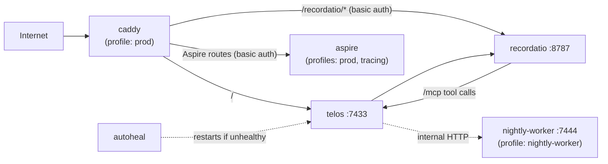

# Deployment and operations

Telos ships as a Docker Compose stack. Compose builds Recordatio from a sibling checkout
(`../recordatio`, using `../recordatio/.env`) alongside Telos.



## Docker

```bash
export GITHUB_TOKEN=...   # build arg for the private Git dependency
# Linux hosts: load the sandbox AppArmor profile first
sudo install -m 0644 deploy/telos-sandbox.apparmor /etc/apparmor.d/telos-sandbox
sudo apparmor_parser -r /etc/apparmor.d/telos-sandbox
make docker-build
make docker-up            # telos + recordatio
make prod-up              # adds Caddy (COMPOSE_PROFILES=prod)
```

Other targets: `docker-down`, `docker-logs`, `docker-restart`, `shell`, `caddy-logs`,
`caddy-reload`, `deploy` (runs `deploy.sh`).

Recordatio listens on `127.0.0.1:8787` only. `RECORDATIO_VPC_LISTEN=<private-ip>:8787` adds a
private-network listener for a remote memory-search caller such as Cardea.

### Sandbox

`python_exec` and `shell_exec` run through `sandbox-runtime`/bubblewrap in a child user
namespace (`SANDBOX_ENABLE_NESTED=1`, set by Compose). The container drops all capabilities
except `SETFCAP`, sets `no-new-privileges`, and loads the `telos-sandbox` AppArmor profile. It
does not get `SYS_ADMIN` or `NET_ADMIN`. Sandboxed code can write its workspace but has no
network and a read-only view of everything else.

Docker Desktop has no AppArmor: skip the `sudo` lines and set
`COMPOSE_FILE=docker-compose.yml:docker-compose.desktop.yml` (Compose ≥ 2.24.4). Do not use that
override on a production Linux host.

Opt-in smoke tests:

```bash
TELOS_BROWSER_SMOKE=1 .venv/bin/python -m unittest discover -s tests -p test_jobber_browser_integration.py -v
# In a disposable Linux container built from the Telos image, without production volumes or secrets:
TELOS_SANDBOX_SMOKE=1 .venv/bin/python -m unittest discover -s tests -p test_jobber_sandbox_integration.py -v
```

The browser test needs `patchright install chromium` first.

## HTTPS (Caddy)

Set in `.env`:

| Variable | Purpose |
|---|---|
| `PUBLIC_HOST` | Hostname Caddy obtains a certificate for; also marks auth cookies `Secure` |
| `RECORDATIO_PASSWORD_HASH` | bcrypt hash for the `/recordatio/*` and Aspire basic auth (user `recordatio`). Generate with `make recordatio-hash PASS=...` |

Recordatio has no authentication of its own, so keep it behind this gate.

## Continuous deployment

`.github/workflows/deploy.yml` runs on every push to `main`: it bumps the patch version, then
SSHes to the host, pulls Telos and Recordatio, reloads the AppArmor profiles, and rebuilds and
restarts the stack (force-recreating Caddy when the `Caddyfile` changed). Required secrets:
`DEPLOY_HOST`, `DEPLOY_USER`, `DEPLOY_SSH_KEY`.

## Tracing

```bash
make aspire    # Aspire UI on :18888, OTLP on :4317/:4318 (or: make jaeger, UI on :16686)
export OTEL_EXPORTER_OTLP_ENDPOINT=http://localhost:4317
export VITE_OTEL_EXPORTER_OTLP_ENDPOINT=http://localhost:4318/v1/traces
make dev
```

Start Recordatio with the same `OTEL_EXPORTER_OTLP_ENDPOINT` to continue traces through it.
The collectors bind to `127.0.0.1` and accept browser OTLP only from the Vite origins;
override with `OTEL_BROWSER_CORS_ALLOWED_ORIGINS`. In production, don't expose a collector with
wildcard CORS — build the SPA with a same-origin endpoint (e.g.
`VITE_OTEL_EXPORTER_OTLP_ENDPOINT=/otlp/v1/traces`) and have the proxy forward only that path to
the collector's `/v1/traces`.

## Google Docs / Sheets

Each user connects their own Google account from `/profile`. The deployer sets up one OAuth
client:

1. In Google Cloud, enable the Drive, Docs and Sheets APIs.
2. Create an OAuth 2.0 **Web application** client. Its redirect URI must equal
   `GOOGLE_OAUTH_REDIRECT_URI` (e.g. `https://telos.example.com/oauth/google/callback`).
3. Add the scopes `drive.metadata.readonly`, `documents`, `spreadsheets`, `openid`, `email`.
4. Put `GOOGLE_OAUTH_CLIENT_ID` / `GOOGLE_OAUTH_CLIENT_SECRET` in `.env` and restart.

Refresh tokens are stored per user in `registry.db`.

## Search and browsing

- `SEARCH_ENGINE=serper` falls back to DuckDuckGo for an hour when Serper reports exhausted
  credits. `duckduckgo` needs no key. `bing` searches Bing through DDGS with **no**
  fallback (it is not the Microsoft Bing Search API).
- Browser tools follow new tabs and extract PDF text in a bounded child process (20 MiB,
  200 pages, 500,000 characters, 15 s parse timeout). Long pages return `next_offset`; keep
  calling `browser_read` with it until it is absent. A 403/406 is reported as an access failure.
- `TELOS_UNBLOCKER_URL` optionally routes bot-walled pages through a render-and-solve proxy;
  see [real_estate_agents_xhr.md](real_estate_agents_xhr.md#unblocker-render-and-solve-proxy--the-walled-spa-path).

Browser state is scoped to user, agent and the `X-Telos-Turn-Id` header, and closed when the
turn ends. Tool calls and results, recall, and routine email delivery are stored with each turn
in the agent's `history.db` (credentials and image data excluded) so nightly evaluation can
score task completion separately from response quality.

`ROUTINE_RECALL_QUERIES` reserves up to three memory queries for a `user/agent` scope:

```dotenv
ROUTINE_RECALL_QUERIES={"owner/jobber":["submitted applications and subsequent status updates"]}
```

## Nightly coding worker (Linux, optional)

The nightly implementer turns improvement proposals into draft PRs. On Linux it can run in a
separate, locked-down container: read-only root, no production data, no source or Docker socket
mounts, no published port, all capabilities but `SETFCAP` dropped.

1. Install `deploy/telos-nightly.apparmor` as `/etc/apparmor.d/telos-nightly` and load it with
   `apparmor_parser -r`.
2. In `.env`: `COMPOSE_PROFILES=prod,nightly-worker`,
   `NIGHTLY_WORKER_URL=http://nightly-worker:7444`, and a random `NIGHTLY_WORKER_TOKEN`
   (≥ 32 characters).
3. `docker compose build && docker compose up -d`.

Before a Codex turn the worker checks that it can commit inside the workspace and cannot write
outside it. One job runs at a time. Without `NIGHTLY_WORKER_URL`, the implementer runs locally.
